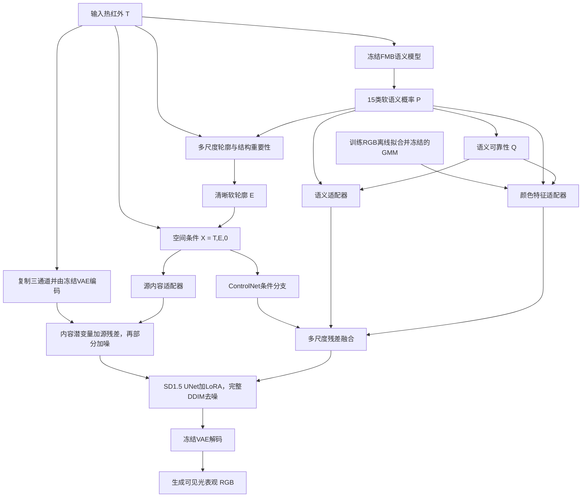

# D系列组会说明：当前流程、模块与实现边界

整理日期：2026-10-28。依据本地正式`D.unpaired`源码及默认配置，解释原版正式D（配置V1），另列本地V2修订与后续计划。用户报告Windows正在训练；本机尚未读取该进程的`run.json`与实际结果，因此默认配置、文档方案与正在运行的具体参数需区分。本轮只整理说明，没有启动或改变训练。

## 1. 组会开场：研究什么问题

建议题目：**结构与语义先验引导的无配对热红外图像彩色化**。

可以这样开场：

> 我的研究面向热红外到可见光表观的无配对生成。现有方法可能生成颜色较自然但目标位置、边界或类别发生变化的图像，也可能保留轮廓却出现区域混色。因此，我从结构条件、语义条件和RGB学得颜色分布三个方面约束生成过程：让模型利用原始红外内容，保留重要结构，同时生成与场景类别相符的颜色。当前已将这些条件迁移到预训练扩散生成器，正在进行正式无配对训练。显式轮廓补全及其结构可靠性控制是下一阶段工作。

目标是**结构忠实、语义一致、颜色合理的候选外观**。热红外不能唯一决定服装／车身等真实颜色，不把生成的颜色当作新增观测。最终还希望检验生成表征能否在人车检测中提供额外收益；该应用结论尚未验证。

## 2. 基础骨干、训练框架与实验基线

需要分开三个概念：

1. **生成骨干**：预训练Stable Diffusion 1.5＋预训练Canny ControlNet。VAE负责图像／潜变量转换，UNet完成去噪，ControlNet承接空间条件。
2. **适配框架**：正向为可微多步扩散生成器，反向为RGB→TIR ResNet9，另有RGB／TIR两个PatchGAN；使用无配对双向循环与辅助目标。
3. **实验基线**：旧CycleGAN是历史工程对照；当前扩展D还改变了训练目标和处理方式。不能直接把全部差异归因于扩散骨干。模块比较应在同一D骨干、同样条件和训练预算中进行，参见[骨干对照边界](../D/BACKBONE_BASELINE.md)。

因此可称为：**基于预训练扩散模型的结构／语义条件无配对循环适配框架**。它仍使用对抗与循环训练；不能因为采用diffusion就忽略这些组成，也不是从零训练全部SD参数。

## 3. 总体信息流



图中Q调节条件的依赖强度，不等于语义一定正确。R已参与生成E；不再把整张E额外重复乘一次R。第三通道C仍为零占位。

## 4. 先区分六个量

| 符号 | 含义 | 回答的问题 |
|---|---|---|
| T | 原始热红外内容 | 场景中有什么红外观测？ |
| E | 连续软轮廓强度 | 哪里有多强的边界线索？ |
| R | 结构／语义重要性 | 哪些已有线索应优先保留？ |
| P | 15类软语义概率 | 这个位置可能属于什么类别？ |
| Q | 语义可靠性代理 | 对这份语义条件应该依赖多少？ |
| C | 尚未实现的结构可靠性 | 对原始／新增轮廓应该依赖多少？ |

叶片纹理可能真实清晰但任务重要性较低；脚部弱边可能重要却不确定。R和C分别解决重要性和可信程度，不能混为一个删纹理分数。P、Q及未来C未经标注校准时，不自动等于真实正确率。

## 5. 模块一：多尺度清晰软轮廓与联合重要性

### 5.1 为什么需要显式轮廓

T保留全部红外内容；E提供额外的空间结构提示。单组Canny阈值容易在弱边漏检、在密集纹理处产生大量响应。软轮廓允许候选具有连续幅度，但幅度不是已校准的边缘概率。

### 5.2 当前提边方式：clarity_v1

当前正式D明确调用`clarity_components(..., include_probes=False)["clarity_v1"]`：

1. 在原TIR上估计噪声量级，轻度非局部均值去噪后与原图各保留一半；只用于提候选，原始TIR内容与语义输入不被替换。
2. 用三组平滑尺度0.7／1.0／1.6、三组高阈值0.12／0.16／0.20（低阈值为一半）提取Canny硬边。
3. **先投票，再沿红外梯度法向提取响应峰并细化**，减少相邻候选叠加产生的宽边和重影。
4. 将脊线按距离软化，宽度参数为0.5像素；邻近强度随距离衰减。
5. 用原TIR上的联合重要性、密集纹理代理及整体贡献系数融合细／粗候选，并保留原细边脊线的弱下限。

主路没有使用额外锐化或Weber探针，它们是对照。没有显式搜索缺口或连接端点，不能把脊线整合称为已完成补边。当前D也没有启用后来另写的`recall_v1`。

### 5.3 显著性如何计算

结构重要性采用固定算法，结合：结构张量的方向一致性、局部对比度、细边密度与相对粗边的额外密度。连贯且有对比的结构获得更多支持；密集细纹理倾向被减弱。

它不是接受眼动／显著目标真值训练的注意力网络，也不能独立识别人车。

语义重要性使用重要类别的概率和：

\[
S=\sum_{c\in\{person,car,truck,bus,motorcycle,bicycle,building\}}P_c,
\qquad R_{sem}=0.18+0.67S.
\]

这些类别在此处等权。联合重要性为：

\[
R_{joint}=R_{sem}+(1-S)(1-D_{tex})A\,[R_{str}-R_{sem}]_+,
\]

其中`D_tex`是纹理密集程度代理，A只允许在细候选相对粗候选有优势的位置补充结构重要性。

含义：语义支持不足时，如果已有结构证据更强、纹理不过密，则补回一部分关注；没有新增候选，也不能恢复所有被语义漏掉的人。

### 5.4 完整E融合关系（技术备份）

将融合函数记为：

\[
\mathcal F(F,B,R,D)=\max\{0.25F,\,[RF+(1-R)0.5B](1-0.4D)\}.
\]

当前清晰分支使用新提取的细／粗软候选`F_clr/B_clr`，沿用原TIR计算的`R_joint/D_tex`，并增加重要性对应的整体贡献：

\[
g(R)=0.25+0.75\operatorname{clip}\left(\frac{R-0.18}{0.85-0.18},0,1\right),
\]

\[
E=\max\{0.25E_{raw\_fine\_ridge},\;g(R_{joint})\mathcal F(F_{clr},B_{clr},R_{joint},D_{tex})\}.
\]

`E_raw_fine_ridge`由旧细候选的脊线以新宽度软化得到，不等于旧宽软图的逐像素保底。联合R的优势A使用原候选计算；清晰版本改变候选表达，不重新调R或D。

来源：[轮廓实现](../pytorch-CycleGAN-and-pix2pix/models/clarity_semantic_edges.py)、[联合重要性](../pytorch-CycleGAN-and-pix2pix/models/semantic_edges.py)、[结构重要性](../pytorch-CycleGAN-and-pix2pix/models/saliency_edges.py)。

## 6. 模块二：冻结语义P与可靠性Q

输入TIR经冻结FMB SegFormer-B3，在512短边策略下得到15类P，再恢复到TIR坐标。正式D保留完整软概率，不把它先变成硬彩色标签图。

Q的核心为：

\[
Q=(p_{(1)}-p_{(2)})(1-H_{norm}(P))\,
\left(1-\frac12\|P-\widetilde P_{flip}\|_1\right)\,M_{interior}.
\]

其中前两项衡量类别区分度与不确定性，第三项衡量翻转后还原到原坐标的预测一致性；类别边界附近按当前半径规则置低／置零，降低伪标签边界误差的影响。

Q同时用于独立语义注入、颜色先验强度和可信区域损失。**高Q错分仍会通过**，例如两次都把树冠误认成天空。Q不会修改P本身，也不是语义纠错网络。

## 7. 模块三：从RGB离线学习多峰颜色先验

### 7.1 两个语义模型各做什么

| 模型 | 输入与职责 | 是否随彩色化训练更新 |
|---|---|---|
| FMB SegFormer-B3 | 分析真实／合成TIR，提供15类P | 冻结 |
| RGB SegFormer-B2教师 | RGB训练图伪标签、RGB条件缓存、生成RGB语义一致性 | 冻结；分析生成图时保留图像梯度 |

RGB教师原为19类Cityscapes分类，正式语义一致性中显式映射到FMB的15类。比如rider并入person，部分无法对齐的类别并入background。

这里的“教师”是固定的伪标签／监督来源，没有新建一个在线预测固定RGB模板的教师，也不意味着学生必须逐像素复制某张彩色图片。使用已有带标注预训练知识，因此“无配对”不等于没有任何外部监督来源。

### 7.2 离线拟合

从训练RGB中用教师筛选高概率、类别间隔足够、翻转一致且经过区域内部腐蚀的像素；以Lab空间的a/b色度样本拟合每类小容量对角GMM：

\[
p_c(a,b)=\sum_{k=1}^{K_c}\pi_{ck}\,\mathcal N((a,b);\mu_{ck},\operatorname{diag}(\sigma^2_{ck})).
\]

多峰分布允许植被、路面、天空等具有多个合理色度模式，不用单一平均色替代。具体支持类别／分量数必须查看实际先验JSON；文档列道路、人行道、植被、天空，不能未经核对就宣称生产文件全部支持，更不能推断车身／服装真色。

代码中的过拟合控制：视频／场景分组划分；每图／每组采样上限；方差下限；预声明小容量K候选；按组验证NLL选择“在最佳一个标准误范围内最小的K”；训练—验证差距与组bootstrap诊断；独立组数不足则unsupported。参数／颜色支持阈值由训练样本拟合，验证用于选择容量，test不参与拟合／选择。以上是控制措施，不是泛化已成立的证据。

### 7.3 正式生成如何使用先验

每个GMM分量提供5个统计特征：比例、两个加权归一化色度中心、两个加权归一化标准差。它们经对应P通道形成空间特征；所有分量都保留。

先验强度为：

\[
G_{color}=Q\left(\sum_{c\in\mathcal C_{supported}}P_c\right)
\mathbb 1[\arg\max P\in\mathcal C_{supported}].
\]

特征通过可训练颜色适配器进入扩散残差；GMM本身冻结。预览中的彩色提示图只用于展示，不是网络真正收到的固定颜色答案。网络还要结合TIR、E、语义、生成先验与训练目标生成输出。

来源：[拟合](../scripts/color_prior_learning/fit.py)、[颜色特征与色度损失](../pytorch-CycleGAN-and-pix2pix/models/learned_color_prior.py)。

## 8. 模块四：带原始内容路径的可微扩散生成

### 8.1 为什么同时保留T和E

E是稀疏且有误差的条件，仅依赖它可能丢掉区域内部信息。当前两条内容路径为：

\[
z_{src}=\operatorname{VAEEnc}(\operatorname{repeat}_3(T)) + A_{src}([T,E,0]).
\]

VAE输入是复制三通道并按VAE范围归一化的TIR；`[T,E,0]`只作为空间条件与源适配器输入。源适配器包含三次步长2下采样及4通道输出，末层零初始化。360×288对应45×36、4通道潜变量。

### 8.2 多条件怎样进入UNet

X进入ControlNet，输出多个down／mid残差。语义与颜色先经各自两层3×3卷积编码为16通道，再由各残差位置的1×1投影对齐通道数，加入ControlNet残差：

\[
\widehat r_l=r_l^{ControlNet}
+Q_l\,h_l^{sem}(\phi_{sem}(P))
+G_{color,l}\,h_l^{color}(\phi_{color}(K(P))).
\]

该式省略了尺度变换。语义／颜色投影零初始化，让新分支从零残差开始学习；E内部已有语义，因此不代表整个初始系统没有语义信息。

若由旧RGB软E预热初始化，旧ControlNet输入为`[E,E,E]`，将三个输入卷积核求和放入新E通道，TIR／C核先置零，以保留原E响应。TIR使用能力在后续训练中逐步学习。

### 8.3 生成与适配方式

在`z_src`上部分加噪，再由SD1.5 UNet＋ControlNet和独立条件残差完整去噪，最后VAE解码。默认10个DDIM总时间步、strength0.4，实际运行4次去噪；CFG1。训练和推理采用相同采样定义，正式损失反传经过全部4步，而不是只训练末步。

UNet交叉注意力加入rank4 LoRA，只学习小规模低秩更新；ControlNet主要训练条件编码和输出投影。大部分预训练参数冻结，保留通用RGB生成知识。固定街景文字提示也提供场景先验，应作为领域假设报告。

来源：[生成器与融合](../D/unpaired/model.py)、[部分参数适配](../D/adaptation.py)。

## 9. 无配对训练为什么成立

定义G为TIR→RGB扩散生成器，H为RGB→TIR反向ResNet9。

```text
独立采样 T_i ──G──> RGB_hat_i ──H──> T_rec_i
             RGB域D判真假         与同一T_i计算循环损失

独立采样 Y_j ──H──> T_hat_j ──G──> RGB_rec_j
             TIR域D判真假          与同一Y_j计算循环损失
```

`T_i`与`Y_j`不要求同一场景。不会计算`|G(T_i)-Y_j|`作为随机跨域像素真值。两域判别器学习各自分布，循环重建对象始终是同一个原始输入。

反向循环的合成TIR会重新生成E/P/Q。这些固定前端结果detach；原始合成TIR张量仍经VAE／源内容路径保留梯度，所以RGB重建损失可以更新H。真实图像的条件提前缓存，随参数变化的合成TIR条件在线重算。

两侧循环和回放分别建立／反传计算图，累计梯度后更新G及H，再独立更新D，降低同时保留所有计算图的显存需求。循环一致性只是约束，不保证没有目标幻觉或隐藏信息，仍需独立结构验证。

## 10. 各损失分别约束什么

生成侧总目标可概括为：

\[
\begin{aligned}
\mathcal L={}&\mathcal L_{adv}
+10\mathcal L_{cyc,T}+10\mathcal L_{cyc,R}
+\mathcal L_{edge}+0.2\mathcal L_{content}\\
&+0.1\mathcal L_{sem}+0.01\rho(s)\mathcal L_{color}
+0.02\mathcal L_{smooth}+I_{replay}(s)\mathcal L_{noise},
\end{aligned}
\]

`rho(s)=min((s+1)/1000,1)`；回放默认每4次更新一次。D另有各自的LSGAN目标。

| 损失 | 当前实现 | 作用及边界 |
|---|---|---|
| 对抗，权重1 | 两域LSGAN，PatchGAN判别局部图像真实度 | 促进目标域表观，不能单独保证输入结构 |
| TIR循环，10 | `L1(H(G(T)),T)` | 保留可重建的TIR内容 |
| RGB循环，10 | `L1(G(H(Y)),Y)`，G的条件由H(Y)重算 | 限制反向翻译造成的信息丢失 |
| 轮廓，1 | 生成灰度Sobel梯度的局部支撑＋方向，方向取绝对内积 | 支持已有E，允许热／可见光对比极性相反；不强制亮度相同 |
| 内容，0.2 | 8邻域固定局部自相似描述子、同位置正样本／同图其他位置负样本 | 减少局部布局替换；不是CLIP／CUT／JR复现 |
| 语义，0.1 | RGB教师分析生成图，与源P比较；Q门控、按有效类别平衡 | 促进类别一致，源语义错误也可能被强化 |
| 颜色，0.01并渐增 | 高Q且受支持类中的Lab a/b超额GMM负对数似然 | 越过训练色度支持范围才惩罚，不持续把合理颜色拉向均值 |
| 色度平滑，0.02 | V1中相邻硬类别相同且E弱时平滑色度差 | 减少区域割裂；原版未用Q，V2已另作候选修订 |
| RGB噪声回放，1／每4更新 | 对真实RGB自身潜变量随机加噪，预测噪声／速度 | 维持条件生成能力，减少适配时遗忘；是RGB自身配对，不是跨域配对 |

颜色超额惩罚细节：令`n_c=-log p_c(ab_hat)`，训练RGB确定支持阈值`tau_c`，则惩罚为`[n_c-tau_c]_+/(1+[n_c-tau_c]_+)`，再由Q与该类P调节。故当前微量颜色目标是有界的软约束。

本地RGB教师实际随机小型SegFormer测试确认：教师参数没有梯度，生成图获得非零有限梯度。固定教师不等于给生成图做no_grad。来源：[损失](../D/unpaired/losses.py)、[训练引擎](../D/unpaired/engine.py)、[教师](../D/unpaired/semantics.py)。

## 11. 哪些学习、哪些冻结；训练与推理的区别

| 组成 | 是否学习 | 推理是否需要 |
|---|---|---|
| 多尺度提边、重要性、Q计算 | 固定规则 | 需要，或使用已缓存条件 |
| FMB语义模型 | 冻结 | 需要，或使用已缓存P/Q |
| GMM颜色分布 | 训练RGB离线拟合，之后冻结 | 需要先验文件 |
| 源适配器、语义／颜色适配器 | 学习 | 需要 |
| ControlNet条件编码／输出投影 | 学习；其余主干冻结 | 需要 |
| SD UNet LoRA | 学习；主干冻结 | 需要 |
| VAE | 冻结，但保留图像梯度 | 需要 |
| RGB教师 | 冻结，生成图路径可微 | 正向生成不需要调用 |
| RGB→TIR反向网络与两个D | 学习 | 正向生成不需要调用 |

推理只需当前TIR、由其得到的条件、冻结先验和正向生成器，不需要与TIR对应的真实RGB。现有缓存脚本可能为配方记录加载RGB教师，这与生成器前向是否使用RGB输入是两回事。

## 12. 实验实际分为哪些阶段

1. **零训练D0/D1**：同一预训练img2img管线，比较是否施加E条件，不代表已学会TIR域。
2. **RGB软E预热**：`D.train`使用真实RGB潜变量、对应`[E,E,E]`及噪声预测目标，训练部分ControlNet适应软E。灰度RGB在前端用于提E，不是正式三通道TIR条件；这一步没有学习真实热红外配对。
3. **真实TIR无配对训练**：`D.unpaired.train`启用`[TIR,E,0]`、独立语义／颜色、反向网络及上述目标。正式训练内RGB回放已经使用`[Gray(RGB),E_RGB,0]`。
4. **验证选权重与测试**：固定验证图做排错，完整val选候选检查点，最后报告完整test。当前代码没有自动选best，latest是最后完整检查点。

默认D输入为协议处理后的360×288整图，在D阶段不做旧GAN的随机256裁剪。全量协议训练规模为TIR1420、RGB5531；val TIR690；test TIR112、RGB696。它们不是本机已确认的Windows实际缓存数量。训练按更新step计数，内部4步去噪与训练step／epoch不同。

## 13. 原版、V2与未来工作，组会必须分开

| 内容 | 状态 | 可如何表述 |
|---|---|---|
| clarity_v1＋联合重要性、P/Q、学得GMM、可微扩散及无配对目标 | 已有正式源码，用户报告Windows训练中 | 已实现并进入训练验证，效果待完整结果 |
| Q先筛选／归一化聚合／逐层支持掩膜的融合 | 本地V2候选，未同步正在运行的Windows任务 | 针对低Q上下文传播提出修订，实现检查通过，真实收益待验证 |
| 软语义＋相邻Q的色度平滑 | 本地V2候选 | 减少不可靠分类区的平滑依赖，需独立消融 |
| recall_v1 | 旧轮廓分支已有代码，但当前D未启用 | 后续可作为独立候选，不描述成当前D结果 |
| 显式缺口补全、来源记录 | 尚未实现 | 下一步研究 |
| 结构可靠性C／对新增候选拒绝 | 尚未实现，C通道全零 | 下一步研究，不能用Q或边缘强度替代 |
| SAM | 讨论过但未接入 | 可选工具，非当前模块 |
| 下游检测增益、外部泛化 | 尚未完成独立验证 | 研究目标与评价路线 |

V2的动机：原版先卷积后门控，低Q错误P仍可影响可信邻居；原色度平滑不看Q。V2对直接语义／颜色分支先按支持度筛选、归一化池化，再逐层屏蔽无支持位置并门控输出；平滑使用软类别相似度和相邻Q。但P仍参与E，高Q误分仍存在，不能声称语义错误已被消除。

本地45项CPU检查含随机小型Diffusers完整更新、回放、冻结教师梯度、V1／V2签名及隔离检查；不是完整SD权重的收敛或质量证明。详见[审查记录](D系列融合与无配对训练审查_2026-10-28.md)。

## 14. 组会最后说什么：证据与下一步

建议总结：

> 当前我已经完成从固定软轮廓与联合重要性、冻结语义到RGB学得颜色先验的条件链，并将其接入可微扩散生成器，通过双向循环和多项约束实现真实TIR的无配对适配。现在正在验证这一版能否在改善颜色合理性的同时保持人车结构。本地针对可靠性融合又做了两个可独立消融的修订。下一阶段会在训练结果基础上，研究有局部证据支持的缺口候选补全，以及对新增轮廓的可靠性评价与拒绝使用，最后验证生成表征的检测增量价值。

先固定骨干、初始权重、数据／噪声种子、样本与更新预算，拆分只改融合、只改平滑和组合；以后补边比较不补、全部补、相同候选经可靠性筛选。轮廓变亮或测试通过不能充当精度改善。

生成看FID/KID及结构／目标保持复核；没有逐帧配对RGB真值时，不把任意两图的PSNR／SSIM当任务准确率。12张预览不代替完整分布评测。下游检测比较A=T，B=T＋共同语义／结构条件，C=B＋生成图／特征，重点看C相对B的增量。当前未验证，不能写成已提升检测性能。

## 15. 可直接改成组会的8页顺序

| 页 | 主问题 | 主要内容 |
|---|---|---|
| 1 | 要解决什么具体问题？ | TIR外观生成中的结构偏移、错译、混色，目标与真实颜色边界 |
| 2 | 方法整体怎么走？ | 总体数据流，T/E/R/P/Q/C职责 |
| 3 | 为什么轮廓更清晰、更关注人车？ | 多尺度投票、脊线软化、结构／语义联合重要性 |
| 4 | 语义与颜色先验如何获得？ | 双教师职责、Q、多峰GMM及过拟合控制 |
| 5 | 多条件如何融合到diffusion？ | VAE原始内容路径、源适配器、ControlNet多尺度残差与LoRA |
| 6 | 没有配对图怎么训练？ | 两个循环、两域D、辅助目标、RGB回放、梯度路径 |
| 7 | 当前做到哪里？ | Windows训练、V2本地候选、当前实际验证与失败风险 |
| 8 | 后续怎样证明有价值？ | 条件消融、补边与C、结构真实性、检测增量及外部场景 |

演讲时先讲问题与机制，再给公式；每个模块都用“输入是什么—做了什么—期望解决什么—目前有什么证据”的顺序。不要把全部源码超参数堆在主讲页，完整轮廓公式、GMM细节和损失权重可放备份。
